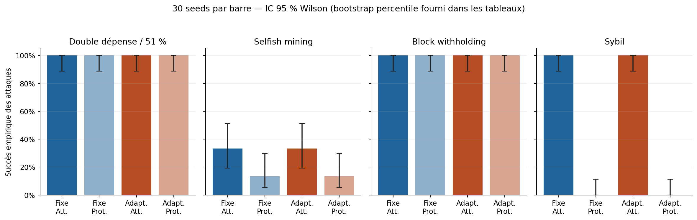
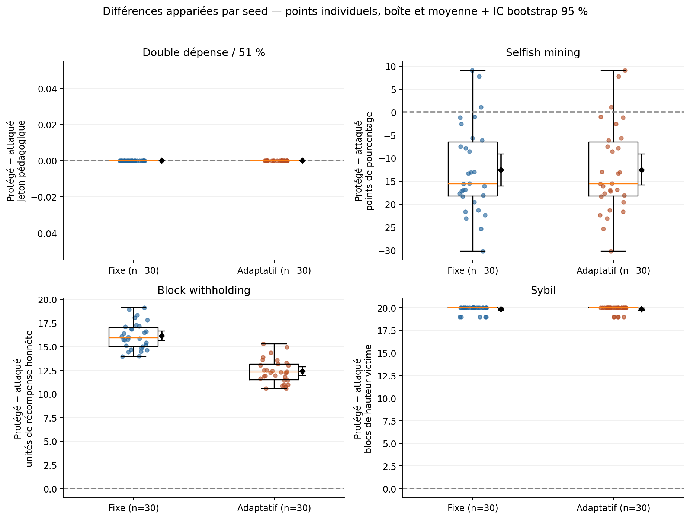
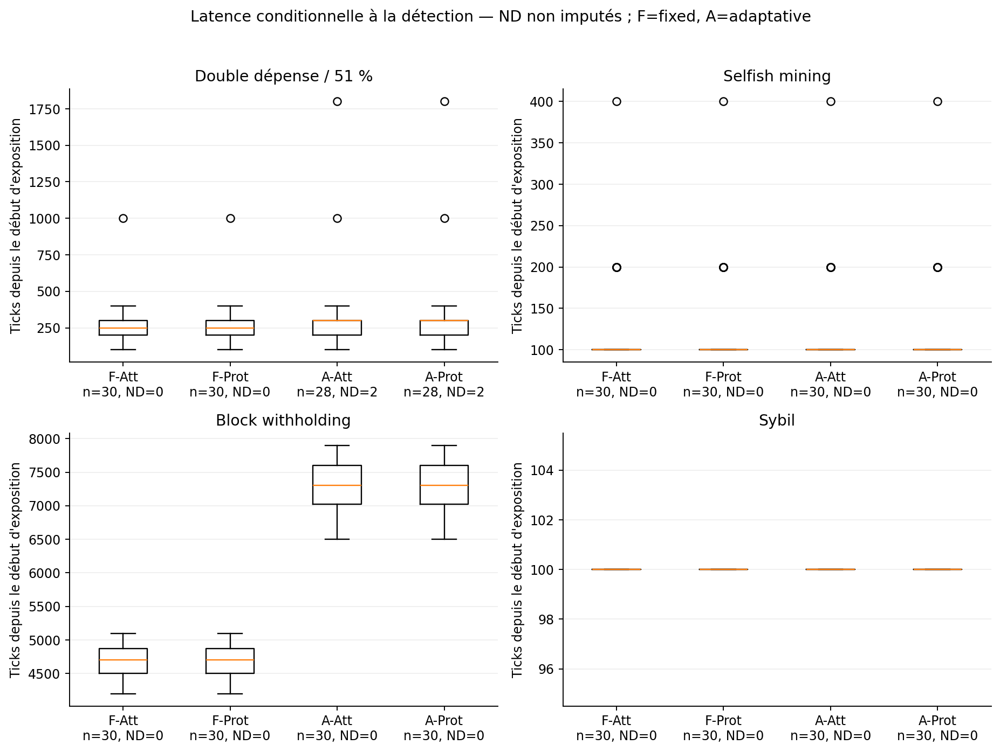
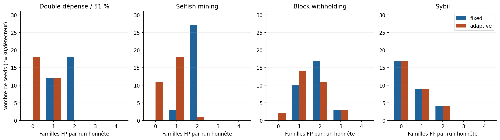
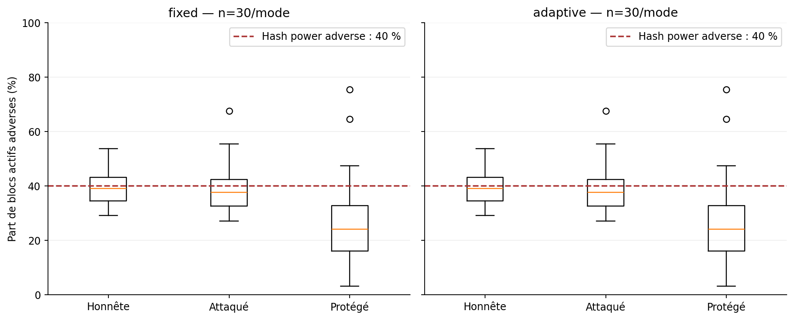
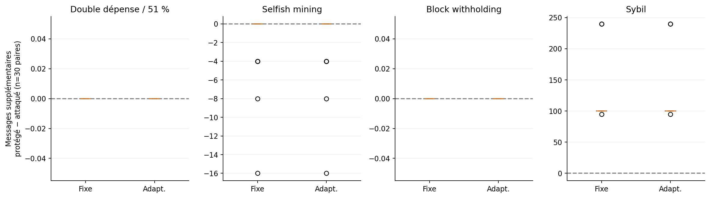

# Blockchain Security Lab — Benchmark M5 (moteur M4 gelé)

## Exécution et protocole

**720/720 simulations évaluées valides**, 30 seeds pour chacune des 24 combinaisons ; 0 échec de processus C++.
En complément : 4 calibrations honnêtes et 3 essais pilotes, soit **727 lancements C++ au total**. La reprise a relu les résultats validés sans nouveau lancement.
60 erreurs initiales de résumé Python (`hash` au lieu de `block` dans la trace) ont été corrigées en retraitant les exports existants, sans relancer le C++ ni effacer les erreurs du manifeste.

Seeds finales préenregistrées : 1001, 1002, 1003, 1004, 1005, 1006, 1007, 1008, 1009, 1010, 1011, 1012, 1013, 1014, 1015, 1016, 1017, 1018, 1019, 1020, 1021, 1022, 1023, 1024, 1025, 1026, 1027, 1028, 1029, 1030. Pilote : 9001/9002, avec répétition 9001. Calibration : seed 7 M4 inchangée, référence distincte par attaque. Seed 42 exclue des évaluations.
Les références sont partagées entre les 90 runs adaptatifs de leur configuration, sans ajustement sur les résultats attaqués/protégés. Les deux détecteurs sont réinitialisés entre runs.
Les variations autorisées des JSON M4 sont la seed et le chemin de référence uniquement. Aucun seuil, budget, hashrate, réseau ou mécanisme de défense n'a été modifié.

## Preuve de conservation M4

Commit : `9cd1db52813cdb3fc03ac21fc2a3aab6256ce1d3`. L'empreinte du binaire exécuté est `933ed797816cd66d4ec162536f29d6ebf9f1f7221f685da47f3a782f7d092179`.
Les SHA-256 de **106 fichiers d'entrée et 5 binaires/DLL** sont dans [m5_reference.json](m5_reference.json). L'intégrité est vérifiée au début, à la reprise et à la fin ; le binaire est aussi revérifié entre simulations.
Le préfixe complet de DEVELOPMENT_LOG antérieur à M5 est protégé par longueur et empreinte ; seule une entrée M5 est ajoutée. Les sources/configurations M4, tests et presets sont restés inchangés, même indépendamment du suivi Git.
Aucune compilation ni relance de CTest : les 44 tests M4 étaient validés et le moteur n'a pas changé. Seuls les tests Python de l'orchestrateur/statistiques ont été exécutés.

## Paramètres de référence

| Profil | Nœuds | Hash power | Blocs max | Intervalle moyen (ticks) | Fenêtre (ticks) | Difficulté |
|---|---:|---|---:|---:|---:|---:|
| attack_51 | 3 | 85 / 15 / 0 | 100 | 20 | 2000 | 1 |
| selfish_mining | 3 | 40 / 60 / 0 | 100 | 20 | 2000 | 1 |
| block_withholding | 3 | 40 / 60 / 0 | 100 | 200 | 10000 | 2 |
| sybil | 5 | 60 / 40 / 0 / 0 / 0 | 20 | 100 | 2000 | 1 |

Audits : 100 ticks ; horizon : 100000 ticks (Sybil : 3000), limites événements et file : 100000 ; budget PoW : 1000000 essais. EWMA alpha=0,1, k=3, clip=2, drift_cap=2, cooldown=500 ; aucune optimisation.
La probation selfish reste 100 ticks ; chaque expérience isole la mitigation correspondante. Les configurations originales complètes sont archivées dans [m5_parameters.json](m5_parameters.json).

## Méthode statistique

L'unité indépendante de rééchantillonnage est la **seed**, pas l'alerte, le nœud ou la famille. Les modes et détecteurs d'une même seed sont appariés. Les 720 runs ne sont pas 720 observations indépendantes d'un même effet.
Pour chaque métrique/configuration : n disponible/manquant, moyenne, médiane, écart-type d'échantillon (n−1), min/max, IC 95 % bootstrap percentile des moyennes et médianes, 5000 rééchantillonnages déterministes. Les différences sont formées par seed avant bootstrap.
Les scores principaux sont les scores micro issus des sommes TP/FP/TN/FN M4, avec bootstrap par seed des vecteurs de confusion. Les moyennes des scores par run sont aussi fournies dans la table longue ; elles ne sont pas interchangeables avec les scores micro.
Unité M4 : (run, famille principale), quatre décisions par run. Les alertes d'autres familles restent des FP de classement, même si elles décrivent une anomalie réelle. Baseline n'a pas de positifs : rappel/F1 zéro par convention M4, sans interprétation de performance sur des attaques absentes.
Les latences nulles restent **non détectées/censurées**, jamais remplacées par zéro ou une durée favorable. Les statistiques de latence sont conditionnelles à la détection et leur n est indiqué. La latence part du début d'exposition t=0, pas d'une découverte privée.
Pour les proportions aux frontières 0/30 ou 30/30, le bootstrap peut être dégénéré ; les intervalles Wilson 95 % sont aussi fournis et utilisés dans la figure de succès. Aucun IC ponctuel [1,1] n'est présenté comme preuve de probabilité réelle 1.
Les IC sont conditionnels aux références honnêtes seed 7 gelées et aux paramètres M4. Ils n'intègrent pas l'incertitude d'une nouvelle calibration et ne sont pas corrigés pour des comparaisons multiples.

## Tableau synthétique : runs attaqués et protégés

Succès : moyenne [IC bootstrap 95 %], n=30 par ligne. P/R/F1 : micro sur 30 clusters, pas sur des alertes indépendantes.

| Attaque | Détecteur | Mode | Succès | P | R | F1 | TP / FP / FN | Latence moyenne (ticks), n détectés |
|---|---|---|---|---:|---:|---:|---|---|
| attack_51 | fixed | attacked | 1.000 [1.000 ; 1.000] | 0.492 | 1.000 | 0.659 | 30 / 31 / 0 | 273.3, n=30 |
| attack_51 | fixed | protected | 1.000 [1.000 ; 1.000] | 0.492 | 1.000 | 0.659 | 30 / 31 / 0 | 273.3, n=30 |
| attack_51 | adaptive | attacked | 1.000 [1.000 ; 1.000] | 0.475 | 0.933 | 0.629 | 28 / 31 / 2 | 321.4, n=28 |
| attack_51 | adaptive | protected | 1.000 [1.000 ; 1.000] | 0.475 | 0.933 | 0.629 | 28 / 31 / 2 | 321.4, n=28 |
| selfish_mining | fixed | attacked | 0.333 [0.167 ; 0.500] | 0.500 | 1.000 | 0.667 | 30 / 30 / 0 | 130.0, n=30 |
| selfish_mining | fixed | protected | 0.133 [0.033 ; 0.267] | 0.500 | 1.000 | 0.667 | 30 / 30 / 0 | 130.0, n=30 |
| selfish_mining | adaptive | attacked | 0.333 [0.167 ; 0.500] | 0.577 | 1.000 | 0.732 | 30 / 22 / 0 | 130.0, n=30 |
| selfish_mining | adaptive | protected | 0.133 [0.033 ; 0.267] | 0.500 | 1.000 | 0.667 | 30 / 30 / 0 | 130.0, n=30 |
| block_withholding | fixed | attacked | 1.000 [1.000 ; 1.000] | 0.500 | 1.000 | 0.667 | 30 / 30 / 0 | 4660.0, n=30 |
| block_withholding | fixed | protected | 1.000 [1.000 ; 1.000] | 0.500 | 1.000 | 0.667 | 30 / 30 / 0 | 4660.0, n=30 |
| block_withholding | adaptive | attacked | 1.000 [1.000 ; 1.000] | 0.750 | 1.000 | 0.857 | 30 / 10 / 0 | 7300.0, n=30 |
| block_withholding | adaptive | protected | 1.000 [1.000 ; 1.000] | 0.750 | 1.000 | 0.857 | 30 / 10 / 0 | 7300.0, n=30 |
| sybil | fixed | attacked | 1.000 [1.000 ; 1.000] | 0.682 | 1.000 | 0.811 | 30 / 14 / 0 | 100.0, n=30 |
| sybil | fixed | protected | 0.000 [0.000 ; 0.000] | 0.612 | 1.000 | 0.759 | 30 / 19 / 0 | 100.0, n=30 |
| sybil | adaptive | attacked | 1.000 [1.000 ; 1.000] | 0.682 | 1.000 | 0.811 | 30 / 14 / 0 | 100.0, n=30 |
| sybil | adaptive | protected | 0.000 [0.000 ; 0.000] | 0.612 | 1.000 | 0.759 | 30 / 19 / 0 | 100.0, n=30 |

### Lecture des résultats

- **51 %** : 30/30 doubles dépenses réussies, avec ou sans protection, pour les deux détecteurs. Le fixe détecte 30/30 expositions, l'adaptatif 28/30 ; ses deux non-détections sont conservées. La profondeur maximale de réorganisation à la cible est en moyenne 2,1 blocs, intervalle observé 2–3. Les nouvelles confirmations n'agissent pas sur un paiement déjà accepté.
- **Selfish** : 10/30 runs dépassent le hash power de 40 % sans défense, contre 4/30 protégés. La part active moyenne passe de 38.97 % à 26.39 %. L'attaque non protégée n'est donc **pas rentable en moyenne au sens de ce proxy** sur ces seeds, contrairement à ce que pouvait suggérer la démonstration seed 42. La défense augmente malgré tout la part adverse sur 3/30 paires : son bénéfice moyen n'est pas universel.
- **Pool** : 39,57 solutions complètes retenues en moyenne (31–46 observées). Récompense pool moyenne 98,63 en baseline, 60,43 attaquée et 60,43 protégée : l'audit redistribue mais ne restaure pas les blocs retenus. Le fixe réagit plus tôt et réduit davantage le payout adverse ; l'adaptatif réduit les FP de classement sur l'attaque, au prix d'une latence plus longue. Aucune share honnête non créditée dans les 30 cas protégés par détecteur ; ce zéro observé ne prouve pas l'absence de risque.
- **Sybil** : 30/30 isolements réussis sans défense, 0/30 après protection. Le délai depuis le premier avertissement reste 100 ticks ; le rattrapage génère aussi des alertes de publication faussement attribuées à une autre famille.
Aucun run évalué ne s'est arrêté par horizon/file/événements avec données en transit : 0/720. Cela ne lève pas la censure des non-détections à la fin des runs.

## Baselines honnêtes : faux positifs

| Profil | Détecteur | Familles FP cumulées / 120 unités | Runs avec au moins une FP / 30 |
|---|---|---:|---:|
| attack_51 | fixed | 48 | 30 |
| attack_51 | adaptive | 12 | 12 |
| selfish_mining | fixed | 57 | 30 |
| selfish_mining | adaptive | 20 | 19 |
| block_withholding | fixed | 53 | 30 |
| block_withholding | adaptive | 45 | 28 |
| sybil | fixed | 17 | 13 |
| sybil | adaptive | 17 | 13 |

## Effets appariés par attaque

Les valeurs ci-dessous sont protégé − attaqué, sauf indication. Chaque paire partage seed et paramètres de référence. Les délais/défenses peuvent ensuite faire diverger les trajectoires.

### attack_51

| Détecteur | Mesure | Différence moyenne [IC bootstrap 95 %] | Paires complètes |
|---|---|---|---:|
| fixed | payment_loss | 0.000 [0.000 ; 0.000] | 30 |
| fixed | max_reorg_depth | 0.000 [0.000 ; 0.000] | 30 |
| fixed | accepted_at | 0.000 [0.000 ; 0.000] | 30 |
| fixed | payment_deferrals | 0.000 [0.000 ; 0.000] | 30 |
| adaptive | payment_loss | 0.000 [0.000 ; 0.000] | 30 |
| adaptive | max_reorg_depth | 0.000 [0.000 ; 0.000] | 30 |
| adaptive | accepted_at | 0.000 [0.000 ; 0.000] | 30 |
| adaptive | payment_deferrals | 0.000 [0.000 ; 0.000] | 30 |

Paiements annulés = au plus un jeton pédagogique par run réussi. `accepted_at` compare uniquement les paires où les deux marchands acceptent ; les non-acceptations ne valent pas délai nul. Le nombre exact de confirmations à l'acceptation est **non disponible** : seul le tick d'acceptation est exporté, sans événement séquencé ni seuil appliqué à cet instant. La règle initiale de 2 confirmations est connue. Un coût de fausse suspension sur un run entièrement honnête protégé n'est pas isolable : le protocole M4 ne contient pas ce quatrième mode.

### selfish_mining

| Détecteur | Mesure | Différence moyenne [IC bootstrap 95 %] | Paires complètes |
|---|---|---|---:|
| fixed | adversary_active_share | -0.126 [-0.159 ; -0.091] | 30 |
| fixed | active_share_minus_hash_share | -0.126 [-0.158 ; -0.091] | 30 |
| fixed | target_stale_ratio | 0.077 [0.069 ; 0.085] | 30 |
| fixed | honest_recipient_delays | 121.100 [116.833 ; 125.133] | 30 |
| fixed | honest_producer_payload_delays | 51.133 [48.933 ; 53.133] | 30 |
| adaptive | adversary_active_share | -0.126 [-0.159 ; -0.092] | 30 |
| adaptive | active_share_minus_hash_share | -0.126 [-0.159 ; -0.091] | 30 |
| adaptive | target_stale_ratio | 0.077 [0.069 ; 0.085] | 30 |
| adaptive | honest_recipient_delays | 121.100 [116.900 ; 125.167] | 30 |
| adaptive | honest_producer_payload_delays | 51.133 [48.933 ; 53.233] | 30 |

La part active et son écart au hash power de 40 % ne sont pas une valeur monétaire. Les stale sont ceux connectés hors chaîne dans la vue cible, jamais les blocs privés non publiés. Les reports aux destinataires honnêtes et aux contenus de producteurs honnêtes sont mesurables ; l'effet exact sur des **relais émetteurs honnêtes** est non disponible, car la trace de probation n'exporte pas l'émetteur.

### block_withholding

| Détecteur | Mesure | Différence moyenne [IC bootstrap 95 %] | Paires complètes |
|---|---|---|---:|
| fixed | pool_reward | 0.000 [0.000 ; 0.000] | 30 |
| fixed | adversary_payout | -16.134 [-16.649 ; -15.656] | 30 |
| fixed | honest_payout | 16.134 [15.637 ; 16.642] | 30 |
| fixed | honest_shares_uncredited | 0.000 [0.000 ; 0.000] | 30 |
| adaptive | pool_reward | 0.000 [0.000 ; 0.000] | 30 |
| adaptive | adversary_payout | -12.390 [-12.835 ; -11.965] | 30 |
| adaptive | honest_payout | 12.390 [11.962 ; 12.830] | 30 |
| adaptive | honest_shares_uncredited | 0.000 [0.000 ; 0.000] | 30 |

| Détecteur | Mode | Récompense pool moyenne | Payout adverse moyen | Payout honnête moyen | Runs avec shares honnêtes non créditées |
|---|---|---:|---:|---:|---:|
| fixed | baseline | 98.633 | 39.693 | 58.941 | 0/30 |
| fixed | attacked | 60.433 | 24.311 | 36.122 | 0/30 |
| fixed | protected | 60.433 | 8.178 | 52.256 | 0/30 |
| adaptive | baseline | 98.633 | 39.693 | 58.941 | 0/30 |
| adaptive | attacked | 60.433 | 24.311 | 36.122 | 0/30 |
| adaptive | protected | 60.433 | 11.921 | 48.512 | 0/30 |

Les shares observées incluent celles non créditées. La suspension change le partage des récompenses et ne récupère aucune solution complète retenue. Les pertes honnêtes contre baseline se trouvent dans les différences `attacked_minus_baseline` ; elles intègrent les conséquences réelles sur la chaîne, sans modèle monétaire externe.

### sybil

| Détecteur | Mesure | Différence moyenne [IC bootstrap 95 %] | Paires complètes |
|---|---|---|---:|
| fixed | victim_height | 19.833 [19.700 ; 19.967] | 30 |
| fixed | victim_known_blocks | 19.967 [19.900 ; 20.000] | 30 |
| fixed | recovery_after_reconnect_ticks | non disponible | 0 |
| fixed | sync_messages | 6.733 [1.433 ; 14.267] | 30 |
| fixed | messages | 109.167 [99.667 ; 123.333] | 30 |
| adaptive | victim_height | 19.833 [19.700 ; 19.967] | 30 |
| adaptive | victim_known_blocks | 19.967 [19.900 ; 20.000] | 30 |
| adaptive | recovery_after_reconnect_ticks | non disponible | 0 |
| adaptive | sync_messages | 6.733 [1.433 ; 14.334] | 30 |
| adaptive | messages | 109.167 [99.667 ; 123.333] | 30 |

| Détecteur protégé | Récupération moyenne [IC 95 %], ticks | Médiane | Min–max | n |
|---|---|---:|---|---:|
| fixed | 39.133 [20.199 ; 59.469] | 4.5 | 1–176 | 30 |
| adaptive | 39.133 [20.199 ; 59.567] | 4.5 | 1–176 | 30 |

Le délai de récupération rapporté est **première adoption valide après la première reconnexion**, moins son tick. Il ne signifie pas convergence complète. Une différence appariée avec attacked n'est pas calculable, puisqu'aucune reconnexion n'a lieu dans ce mode. Le total de blocs connus finaux de la victime est observable ; le nombre exact de blocs uniques récupérés **uniquement** par rattrapage est non disponible, faute de provenance des messages. Les messages sync sont des envois, pas des blocs uniques.

## Coûts et ressources observés

Les coûts simulés restent séparés du temps CPU réel. Tables longues et différences appariées incluent messages, événements, évaluations de caractéristiques, échantillons conservés, probation, crédits et reconnexions.

CPU total C++ mesuré par GetProcessTimes, calibrations/pilote inclus : **84.500 s**, n=727 processus. Le wall time est mesuré séparément dans chaque résumé.
Maximum RSS C++ **échantillonné** à environ 10 ms : **13.44 MiB** ; ce n'est pas une garantie de pic exact. RSS de l'orchestrateur observée entre runs : max **29.46 MiB**. Un seul processus de simulation à la fois.
Données de campagne sur disque au moment de l'analyse : **127.13 MiB**. Espace initial disponible : 31.63 GiB. Aucun fichier de résultat n'a été supprimé.
Le coût des seuils est mesuré en opérations logiques, pas en pourcentage CPU du détecteur : le moteur M4 ne profile pas ses sous-modules. Le RSS/temps de l'analyse bootstrap ne doit pas être confondu avec le coût des défenses.
Les temps réels concernent des processus courts, exécutés dans l'ordre déclaré, sans randomisation temporelle ni machine dédiée. Ils peuvent dépendre du cache et de l'activité du PC (dont la préparation locale des outils graphiques). Les comparaisons CPU/wall sont exploratoires ; les métriques simulées restent reproductibles.

| Attaque | Détecteur | Coût protégé − attaqué | Moyenne [IC bootstrap 95 %] | Paires |
|---|---|---|---|---:|
| attack_51 | fixed | messages | 0.000 [0.000 ; 0.000] | 30 |
| attack_51 | fixed | events | 0.000 [0.000 ; 0.000] | 30 |
| attack_51 | fixed | child_cpu_seconds | -0.002 [-0.014 ; 0.011] | 30 |
| attack_51 | adaptive | messages | 0.000 [0.000 ; 0.000] | 30 |
| attack_51 | adaptive | events | 0.000 [0.000 ; 0.000] | 30 |
| attack_51 | adaptive | child_cpu_seconds | 0.008 [0.000 ; 0.017] | 30 |
| selfish_mining | fixed | messages | -1.200 [-2.533 ; -0.267] | 30 |
| selfish_mining | fixed | events | 119.900 [115.733 ; 124.100] | 30 |
| selfish_mining | fixed | child_cpu_seconds | 0.022 [0.010 ; 0.036] | 30 |
| selfish_mining | adaptive | messages | -1.200 [-2.533 ; -0.267] | 30 |
| selfish_mining | adaptive | events | 119.900 [115.600 ; 124.067] | 30 |
| selfish_mining | adaptive | child_cpu_seconds | 0.021 [0.011 ; 0.031] | 30 |
| block_withholding | fixed | messages | 0.000 [0.000 ; 0.000] | 30 |
| block_withholding | fixed | events | 0.000 [0.000 ; 0.000] | 30 |
| block_withholding | fixed | child_cpu_seconds | -0.003 [-0.011 ; 0.005] | 30 |
| block_withholding | adaptive | messages | 0.000 [0.000 ; 0.000] | 30 |
| block_withholding | adaptive | events | 0.000 [0.000 ; 0.000] | 30 |
| block_withholding | adaptive | child_cpu_seconds | 0.009 [-0.002 ; 0.022] | 30 |
| sybil | fixed | messages | 109.167 [99.667 ; 123.333] | 30 |
| sybil | fixed | events | 109.167 [99.667 ; 123.167] | 30 |
| sybil | fixed | child_cpu_seconds | 0.008 [-0.001 ; 0.017] | 30 |
| sybil | adaptive | messages | 109.167 [99.667 ; 123.333] | 30 |
| sybil | adaptive | events | 109.167 [99.667 ; 123.333] | 30 |
| sybil | adaptive | child_cpu_seconds | 0.005 [-0.004 ; 0.014] | 30 |

## Résultats inattendus et limites scientifiques

- Les FP des baselines bruyantes et les anomalies d'autres familles sont conservés. L'adaptatif n'est pas supposé supérieur sur toutes les métriques ; sa latence peut être plus longue.
- Les gains apparents peuvent dépendre de la seed, du nombre fini de blocs, du départage lexicographique et des délais M4. Une diminution moyenne de part active ne prouve pas élimination du selfish mining.
- L'absence de message avertisseur avant une chaîne privée limite la politique marchande ; une alerte après acceptation ne peut sauver le paiement passé.
- Un pool peut rester perdant après audit ; priver de crédit des shares n'est pas prouver une fraude. Les fausses sanctions sont mesurées pour les membres honnêtes dans les runs protégés.
- La défense Sybil suppose un annuaire et des groupes administratifs fiables. Les groupes distincts ne prouvent pas l'honnêteté. Les identités n'ajoutent aucun hash power.
- Une seule référence honnête seed 7 par profil : incertitude de calibration non explorée. Pas de réoptimisation des paramètres après lecture des résultats.
- Les latences des non-détections sont censurées ; une moyenne conditionnelle courte peut être trompeuse sans le nombre de FN. Les horizons d'arrêt sont conservés.
- Les erreurs Python de résumé ont été réparées sur les mêmes fichiers bruts, sans filtrage de seeds ni sélection de résultats favorables. Les empreintes de réparation sont journalisées.
- Portée : modèle PoW pédagogique, pas Bitcoin/Ethereum réel, pas d'extrapolation au PoS, pas de généralisation au-delà des paramètres testés.

## Artefacts

- [Toutes les 720 lignes légères](tables/m5_runs.csv)
- [24 campagnes : taux et scores](tables/m5_groups.csv)
- [Statistiques complètes, n, dispersion et IC](tables/m5_statistics.csv)
- [Différences appariées et comparaison adaptatif/fixe](tables/m5_paired.csv)
- [Protocole préenregistré](m5_protocol.json) ; [paramètres M4](m5_parameters.json) ; [preuves d'intégrité](m5_integrity.json)

### Graphiques

[Version vectorielle SVG](figures/m5_success_rates.svg)

[Version vectorielle SVG](figures/m5_paired_effects.svg)

[Version vectorielle SVG](figures/m5_detection_latency.svg)

[Version vectorielle SVG](figures/m5_honest_false_positives.svg)

[Version vectorielle SVG](figures/m5_selfish_distribution.svg)

[Version vectorielle SVG](figures/m5_network_costs.svg)

